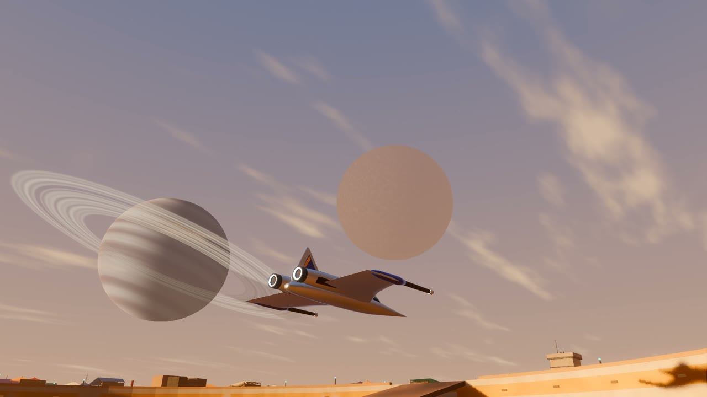

# Desert Spaceport — Vertical Slice

The smallest playable build that proves the concept: a frontier desert spaceport
days after an empire collapses. Land, roam a port district, talk to locals, take a
contract into the desert, fight, return, get paid. Multiple LLM-driven NPCs, like the cantina owner who pushes the plot like a a boomer pushes conspiracy theories.

This is a **vertical slice**, not the full game.

## Promo

[](docs/promo/openspace_promo.mp4)

**[▶ Watch the OpenSpace promo (44 s, 1080p60)](docs/promo/openspace_promo.mp4)**: real
gameplay and in-engine renders. Landing, rifle and blaster fights, the energy sword,
the beast, the moon rave, flying from the port to the star cruiser in orbit, and the
dark master.

## Engine

- **Godot 4.7.2** (pinned in `scripts/pin.txt`; CI checks it).
- GDScript (no C#).
- Dev/target: macOS on Apple Silicon, 64 GB unified memory.
- Windows and Mac share builds: `./scripts/package.sh` (see `docs/SHARING.md`).

## How to run (macOS, Apple Silicon)

```sh
# 1. Install the toolchain once (Homebrew)
brew install --cask godot
brew install rust ffmpeg

# 2. Open the editor and run, OR run headless tests
open project.godot            # in the Godot editor, F5

# 3. Run the headless test + CI gate (no editor needed)
./scripts/ci.sh
```

`./scripts/ci.sh` runs the full GUT suite and the IP-neutrality scan headless and
exits non-zero if anything fails. That non-zero exit is the merge gate.

To run the game on screen and record the 3-minute gameplay clip, see `LAUNCH.md`.

## What exists now (M0)

- IP-neutral **data layer** (`content/core/`) loaded at runtime by `core_content.gd`.
- Every name/faction/weapon/dialogue lives in data files and is referenced by id.
- Tests for the data layer, the IP-neutrality guard, and the CI smoke path.
- Three living docs: `DECISIONS.md`, `CHANGELOG.md`, `KNOWN_ISSUES.md`.

No gameplay yet. M1 adds movement and the camera toggle.

## IP-neutrality rule

No franchise names in code, file names, class names, commit messages, or the data
layer. Generic terms only: "energy blade", "blaster", "imperial remnant", "trooper",
"smuggler". `tests/test_ip_neutral.gut.gd` fails the build if a banned term appears.

## Plan

`PLAN.md` holds the milestones in build order, with status and the "done means"
for each. M0-M12 are done (M10 is starfighter flight and dogfights; M11 the
player's body and hand weapons; M12 the live LLM cantina owner,
`docs/cantina_owner/CANTINA_OWNER_PLAN.md`; M13 the jetpack; M14 flying the ship from the
port to space and back). N1 is the naming system: everything that spawns gets a
generated, unique name (`docs/names/NAMING.md`). P1 is the planet generator: a planet is one
config file (type, town size 1-100, style), and Grit Station, an asteroid you can
fly to from the port's sky, is the first one (`docs/planets/PLANETS.md`). `LAUNCH.md` is how to run and
record the slice, fly the ship, fight in space and use the jetpack. `docs/ADDING_SHIPS.md` is how to add ships, guns, AI pilots and fights
from data; `docs/ADDING_ITEMS.md` is the same for items, vendors and pickups.

## Layout

```
content/core/      the only place names/weapons/dialogue live (swappable)
content/look/      palettes, ship and item looks, lighting (what things look like)
src/systems/       gameplay + support systems (dataloader, player, combat, ai, flight, ...)
scenes/            boot + level scenes; scenes/flight/ is the playable dogfight
tests/             GUT tests + (M5) the headless bot playthrough
scripts/           ci.sh, record.sh, pin.txt
addons/            godot plugins (gut; nobodywho added at M6)
assets/            third-party (CC0 / MIT, with licenses) and generated audio
tools/             render, eval and runtime helpers (tools/llm, tools/m11, ...)
```

## Third-party assets

`assets/third_party/kenney_starter_kit_fps/`: blaster models (CC0) and sounds from
Kenney's Starter Kit FPS (MIT; license text in that folder). The energy sword's
sounds in `assets/audio/blade/` are original, generated by
`tools/audio/make_blade_sfx.py`.

See `DECISIONS.md` for why each significant choice was made.
