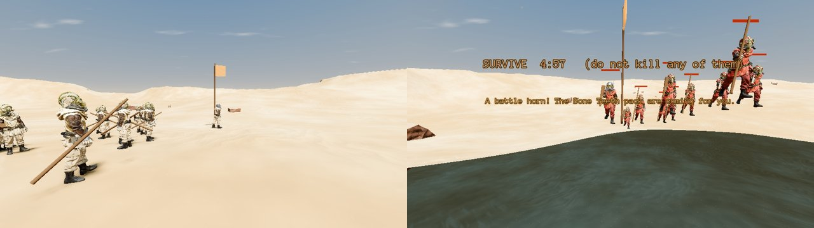
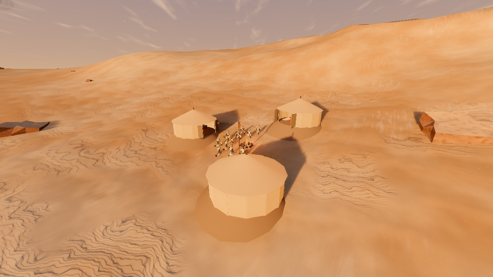
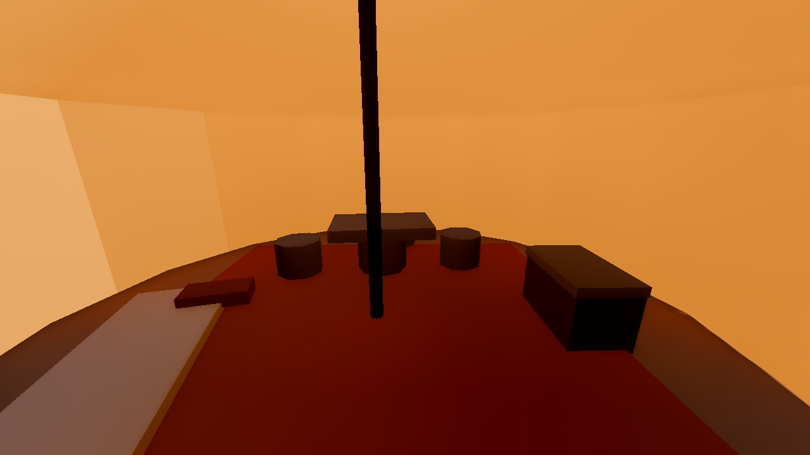

# Native peoples and wild animals (issue #96)

Every planet with breathable ground can have its own native people, who travel in
packs, and its own wild animals. They come from the planet generator, the same way
a planet gets its town, its style and its sky.

## Where they come from

`NativesData.resolve` (`src/systems/natives/natives_data.gd`) gives each planet a
`natives` block (`PlanetGen.build(id).natives`):

- **A planet's own config** can list them outright. The home planet does this in
  `content/core/planets/port_desert.json`: its people, each pack (attitude, size,
  children, style, route, camp) and its animals. `"natives": false` means none.
- **Otherwise its type** decides (`content/core/planets/types.json`, `natives`).
  The type names a people *template*, how many packs there are, how big they are,
  how many are hostile, how many are adults only, how far out they roam, and
  which animals live there. The generator lays all of this out from the planet's
  seed, so a planet always gets the same packs.
  - Each planet makes its own people from the template, named by the name engine
    and keyed to the planet, with the pack colours in its own order. The home
    planet's dune people never turn up anywhere else.
- **Platform and ball planets** (water, lava, gas, the asteroid) get none: there is
  nowhere to live.

## The data

- **A people:** `content/core/species/<id>.json`. A template lists only what
  differs from its `base`. A people has:
  - `body`: the character archetype, the children's scale (0.6), and the
    leader's helmet and pole;
  - `styles`: per-pack colours of the kit pieces already in the game (head
    Goggles, upper body Cantina Owner, lower body Player; the leader wears the
    Cantina Owner head);
  - `soldier`: hit points, speeds and senses, as for a guard;
  - `weapons`: melee and thrown only. The first melee weapon is the chief's;
    each melee weapon names the `move` it plays (a club `swing`, a spear
    `thrust`, a knife `slash`). The thrown one is a rock: a small, short, dark
    bolt with no glow and no sound;
  - `pack`, `trade` (food in, quartz out), `hostile` (the horn, the 5-minute
    survival), `voice` (yells and gesture captions: they do not speak the port's
    language, and never through the voice service) and `lines`;
  - `camp`: the tents, the fire, how many stay at the camp, how long a stop
    lasts, the night hours, the chests' loot table, and how many in-game hours
    a wrecked camp and an emptied chest take to come back;
  - `rest`: the morning hour and the fade.
- **An animal:** `content/core/fauna/<id>.json`. The sand pig has hit points,
  speeds, how far it wanders, when it bolts, and the food it gives.
- **Items:** `food` (sold without end at the food stall in the market) and
  `quartz` (the packs give it for food; the food stall buys it).

## In play

`NativesDirector` (`src/systems/natives/natives_director.gd`) is built by the town
scene when the planet has natives.

- **Packs:**
  - Each member is an `NpcBody`, the guards' body, senses and health. It walks
    open ground without a navmesh (`free_walk`).
  - Far from the player, members are slid along the ground with no physics, so a
    pack can cross the desert where there is no collider under it.
  - The leader walks the route and the rest follow in rows. The leader's pole
    shows where a pack is from far off.
  - They walk round the boulders and mesas the ground knows about
    (`NativeSteer`): boulders too tall to step over, and the mesas, hoodoos and
    outpost landmarks.
- **Camps** (`NativeCamp`, `src/systems/natives/native_camp.gd`):
  - A ring of hide tents round a firepit that is always lit. Each tent is a room:
    a doorway facing the fire, a rug, a rock table and rock seats, a bedroll and
    a chest.
  - A pack starts at its camp. The camp is a stop on its route: the pack sits by
    the fire a while each loop, then walks on. At night (the time-of-day hour)
    it comes in and stays until morning.
  - A few of the pack (the keepers) never leave. They fight only near the camp.
  - **Chests:** each holds a couple of draws from the loot table: food, quartz,
    and what the town's traders and fences buy (refined quantonium,
    holocrystals, unmarked power cells, space whale teeth). **E** takes it all.
    If one of the pack sees you, a friendly pack turns on you (not for good:
    nobody died). A chest fills again a few in-game hours after it is emptied.
  - **Wrecking:** shoot a tent enough and it falls in. Every tent down and the
    camp is wrecked; it is back up a few in-game hours later, once you are not
    standing in it. A friendly pack that sees you shoot its tents turns on you.
  - **Resting:** in a friendly pack's standing tent, **Z** rests. The screen
    fades to black, you heal, the time of day moves on to morning, the game is
    saved, and the screen fades back.
  - **In-game hours** (`WorldState.game_hours`, saved) run at
    `camp.game_hours_per_real_min` and jump when you rest. They only time camps
    and chests: the sky's time of day does not run on its own yet.
- **Moves** (`NativeMoves`, `src/systems/anim/native_moves.gd`): a club swing
  (the blow lands as the club comes down), a rock throw (the rock leaves the
  hand as the arm comes through), and the gestures: a wave as the leader comes
  over, a hand to the mouth then both palms out (food for quartz), a hand to the
  forehead and a bow (thanks), a belly rub and a head shake (no food), weapons
  down and palms open (a truce). The captions still show over the leader's head.
- **Friendly packs:** the leader comes over and gestures. Press **E** to gesture
  back: one food for one quartz, or two from an adults-only pack. Each trade
  raises that pack's reputation (`WorldState.native_pack`, saved).
- **Hostile packs:**
  - They blow a battle horn and come at you on sight, and fight to the last.
  - They swing clubs (and thrust spears, slash knives) up close, and throw rocks
    from 5 to 16 m. The chief never throws.
  - They chase a speeder on foot.
  - **Winning them over:** survive 5 minutes without killing any of them and
    without being downed. They stop, offer trade, and are friendly from then on.
  - **A kill is permanent:** kill one and that pack is hostile for good.
  - **Downed:** you wake as from any other death, and they go back to their
    route.
- **Reputation:** how a pack treats you is its own business, never your standing
  with the Remnant.
- **Animals:** each roams alone and bolts when shot or when you run at it. Kill
  one, then press **E** at the carcass to cut food from it.

## Adding a people or an animal

1. Write `content/core/species/<id>.json` (or a template with a `base`), or
   `content/core/fauna/<id>.json`, and list it in `content/core/manifest.json`.
2. Add it to a planet's config (`natives`), or to a planet type's `natives`, so
   every generated planet of that type gets one of its own.

No code changes are needed for another people, other weapons, colours, pack
sizes, routes, trade goods or animals with the sand pig's shape of data.

## Not yet

- Packs fighting each other and the Remnant: they just roam for now.
- Hiding from sandstorms: there are no sandstorms yet (issue #175).
- Stealing and stripping vehicles (issue #176).
- Camps that move with the season: there are no seasons. A camp stays where its
  data puts it.

`scenes/natives_trace.gd` runs it all headless: the trade, the pig, the hostile
pack and its five minutes, a kill that locks a pack, a rest in a friendly tent,
a chest taken unseen and then seen, rocks and club swings, and a camp shot down
that comes back.
