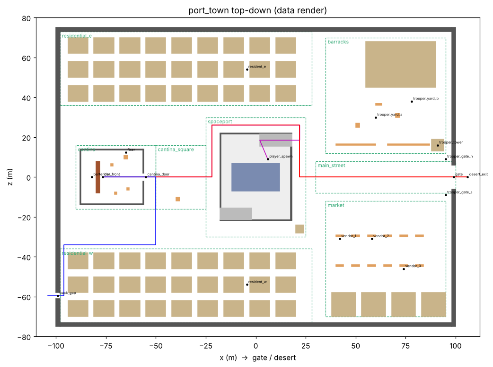

# M9 — Port Town Greybox: Plan and Implementation Guide

This document is for the coding agent. It is split in two:

- **Part A — Planning.** Every decision is already made. Read it, do not change it.
- **Part B — Implementation.** Ten tasks in order, each with files, pseudocode,
  "done when", and the mistakes to avoid.

The full town data is already written and checked: `docs/town/port_town.json`
(112 boxes, 18 markers, 4 routes, 0 validation errors). **You do not invent
coordinates.** You copy the data and write code that reads it.

---

## 0. Rules for the agent (read first)

1. Do the tasks in order (T1 → T10). Do not start a task until the previous one's
   "done when" is true.
2. Work on one branch: `feature/m9-port-town`, off the latest `main`.
3. After every task, run `./scripts/ci.sh`. If anything fails, fix it before moving on.
   Never weaken or delete an existing test to make CI pass.
4. **Never type coordinates into GDScript.** Every number about the town lives in
   `content/core/towns/port_square.json`. Code reads them by id.
5. IP rule still applies: generic words only. Do not add franchise names anywhere.
   `tests/test_ip_neutral.gut.gd` must keep passing.
6. GDScript only, Godot 4.7.2 (see `scripts/pin.txt`). Use tabs for indentation in
   `.gd` files, matching the repo.
7. If you get stuck on the same error three times, stop and write a milestone
   report (template in section B.11) saying exactly what failed.
8. Copy the patterns that already exist in the repo. The closest examples are:
   - `scenes/m1_demo.gd` → building greybox boxes with collision
   - `scenes/m1_trace.gd` + `tests/test_m1_trace.gut.gd` → headless trace + test
   - `src/systems/dataload/core_content.gd` → loading JSON from `content/core`

---

# PART A — PLANNING

## A1. Goal

Replace the 40 x 40 m test floor with a real, walkable greybox town: a walled
desert port with a gate, market, barracks, a sunken landing pit with a parked
ship, a cantina (cantina owner + fixer), and two residential districts. The town is
built at runtime from a JSON file, the player spawns next to the ship, and a
headless bot proves every main route can be walked with real collision.

**Greybox** means plain colored boxes. No art, textures, or models in M9.

## A2. Non-goals (do NOT build these in M9)

- No art pass, textures, imported models, or animation.
- No navigation mesh / NavigationRegion3D baking.
- No building interiors except the cantina.
- No working shops, inventory, or buying.
- No ship take-off.
- No NPC AI wiring. NPCs are static placeholder capsules at their markers.
- No changes to combat, mission, LLM, voice or save systems.
- No changes to `chunk_streamer.gd` logic (we only add chunk descriptors as data).

## A3. Decisions already made

These are fixed. The four marked **(default)** were open questions for Will; they
use a sensible default and can be changed later by editing data.

| # | Decision |
|---|---|
| D1 | Units are meters. 1 Godot unit = 1 m. |
| D2 | **+X points toward the gate, the desert and the outpost.** This matches the existing streamer, which walks along +X from the docking bay to the outpost. |
| D3 | Town footprint: x from -100 to +100, z from -75 to +75 (200 m x 150 m). |
| D4 | Ground top surface is y = 0. The landing pit floor is y = -6. |
| D5 | All geometry is axis-aligned boxes stored as `min`/`max` corners. Ramps are the only rotated shapes, and the code computes their rotation. |
| D6 | **(default)** The player spawns on the pit floor beside the ship. |
| D7 | **(default)** Fights can happen in town, so trooper posts are placed now (as markers only). |
| D8 | **(default)** The market is just there for atmosphere in M9: stalls and solid shop blocks, no interiors. |
| D9 | **(default)** The ship never takes off in M9, but nothing is built over the pit, so the sky above it stays open. |
| D10 | The cantina is the only hollow building (walls, roof, door, bar counter, tables). |
| D11 | The back gap is a 3 m opening in the west wall that leads into a perimeter alley. It is how the smuggler avoids the gate. |

## A4. Map (top-down, +X to the right)



```
 z=+75 ┌──────────────────────────────────────────────────────────────┐
       │ RESIDENTIAL_E (houses, 3 rows)            │ BARRACKS        │
       │                                           │  hall           │
 z=+36 │───────────────────────────────────────────│  crates         │
       │                    ┌───────────┐          │  low yard wall  │
       │ ┌────────┐         │ SPACEPORT │          │        TOWER ■  │
       │ │CANTINA │ CANTINA │  pit +    │          ├─────────────────┤
 z=0   │ │bar  fx │→ SQUARE │  ship     │  MAIN STREET ──────────► GATE ─► desert
       │ └────────┘         │           │          ├─────────────────┤
       │                    └───────────┘          │ MARKET          │
 z=-36 │───────────────────────────────────────────│  stalls x12     │
 back  │ RESIDENTIAL_W (houses, 3 rows)            │  shops x4       │
 gap ◄─│                                           │                 │
 z=-75 └──────────────────────────────────────────────────────────────┘
      x=-100                    x=0                                 x=+100
```

## A5. Zones (2D footprints, `[x, z]`)

| Zone id | min | max | Contents |
|---|---|---|---|
| main_street | [30, -8] | [100, 8] | Empty. The route from the gate. |
| market | [35, -70] | [95, -12] | 4 shops, 12 stall counters, 3 vendors |
| barracks | [35, 12] | [95, 70] | Hall, watchtower, low yard wall, crates, 5 trooper posts nearby |
| spaceport | [-25, -30] | [25, 30] | Pit (36 x 44 m, 6 m deep), 2 ramps, ship, dock booth |
| cantina | [-90, -16] | [-50, 16] | Hollow building, bar, fixer table, 3 tables |
| cantina_square | [-50, -16] | [-25, 16] | Open square, 1 crate stack |
| residential_w | [-98, -73] | [28, -36] | 27 house blocks with 3 m alleys |
| residential_e | [-98, 36] | [28, 73] | 27 house blocks with 3 m alleys |

Boxes in zone `ground` (floor slabs) or `perimeter` (town wall) are exempt from
the "inside your zone" rule.

## A6. Data schema (`content/core/towns/port_square.json`)

```jsonc
{
  "id": "port_town",
  "kind": "town",
  "units": "meters",
  "bounds": { "min": [-100, -75], "max": [100, 75] },   // [x, z]
  "player_clearance": 0.6,       // capsule radius 0.4 + 0.2 margin
  "walk_speed_hint": 4.0,        // matches character_controller.walk_speed
  "blocking_kinds": ["wall", "solid", "cover", "counter", "ship"],
  "zones":   [ { "id": "market", "min": [x, z], "max": [x, z] }, ... ],
  "boxes":   [ { "id": "shop_1", "zone": "market", "kind": "solid",
                 "min": [x, y, z], "max": [x, y, z] }, ... ],
  "markers": [ { "id": "fixer", "pos": [x, y, z], "role": "npc", "npc": "fixer" }, ... ],
  "routes":  [ { "id": "gate_to_cantina", "points": [[x, z], ...] }, ... ],
  "chunks":  [ { "id": "town_back", "center": -50.0, "load_ms": 18.0, "kind": "port" }, ... ]
}
```

**Box kinds** and what they mean:

| kind | Blocks walking? | Built as | Notes |
|---|---|---|---|
| floor | no (you stand on it) | static box | Ground slabs and pit floor |
| wall | yes | static box | Town wall, pit walls, cantina walls |
| solid | yes | static box | Houses, shops, hall, tower, booth. You can stand on top. |
| cover | yes | static box | Low (≤1.5 m). Crates, stalls, tables, yard wall |
| counter | yes | static box | Bar counter |
| ship | yes | static box | Placeholder ship hull |
| ramp | no (you walk on it) | **rotated** slab | Has `rise_toward`: "+x", "-x", "+z" or "-z" |
| overhead | no (above head) | static box | Gate and door lintels. `min.y` must be ≥ 2.2 |
| roof | no | static box | Cantina roof |

**Marker roles:** `spawn`, `waypoint`, `interact`, `npc`, `trooper_post`, `ambient`.

**Coordinate conversion (use this everywhere):**
```
center = (min + max) / 2
size   = max - min
```
A Godot `BoxMesh`/`BoxShape3D` is centered on its node, so the node goes at `center`
and the mesh/shape `size` is `size`. **Do not** put the node at `min`.

## A7. Validation rules (the code must enforce all of these)

These are exactly what `docs/town/validate_town.py` checks, and the GDScript
validator in T3 must reproduce them.

| # | Rule |
|---|---|
| V1 | Every box and marker id is unique. |
| V2 | For every box, `min[i] < max[i]` on all three axes. |
| V3 | Every box with kind `overhead` has `min.y >= 2.2`. |
| V4 | Every box whose zone is not `ground` or `perimeter` has its x/z footprint fully inside that zone. Unknown zone ids are errors. |
| V5 | No two boxes overlap in 3D. Touching faces are fine (use strict `<`). |
| V6 | No marker sits inside a blocking box. A marker is blocked when the box's y range contains the marker y (`min.y <= y < max.y`) and the 2D distance from the marker to the box footprint is `<= player_clearance`. |
| V7 | Every marker stands on something: a `floor` or `solid` box (or any box with `"standable": true`, e.g. the cantina stage) whose top (`max.y`) is within 0.05 of the marker y and whose footprint contains the marker x/z. |
| V8 | No route segment passes within `player_clearance` of any blocking box (2D distance, segment to rectangle). |

Reference output (yours must match these numbers to one decimal):
```
gate_to_cantina: 234.5 m, walk 59s, sprint 34s
spawn_to_cantina: 162.3 m, walk 41s, sprint 23s
cantina_to_gate: 234.5 m, walk 59s, sprint 34s
backgap_to_cantina: 140.0 m, walk 35s, sprint 20s
OK, 0 errors
```
Run it yourself: `python3 docs/town/validate_town.py content/core/towns/port_square.json`

## A8. Done means (acceptance criteria for M9)

1. `port_town.json` loads through `CoreContent` and validates with 0 errors in GDScript.
2. Negative tests prove the validator catches each rule breaking (overlap, outside
   zone, blocked marker, blocked route, low lintel, duplicate id).
3. `scenes/town_demo.tscn` opens and shows the full town; the player spawns beside
   the ship, can walk up the ramp, through the streets, and into the cantina.
4. A headless bot walks all 4 routes with real physics and reaches every waypoint;
   no route gets stuck, and nobody falls below y = -10.
5. Worst physics frame during the walk trace is under 50 ms.
6. CI runs the new trace and tests; the full suite stays green.
7. PLAN.md, DECISIONS.md, CHANGELOG.md, KNOWN_ISSUES.md are updated.

## A9. Known traps (read before coding)

| Trap | What happens | Prevention |
|---|---|---|
| Node at `min` instead of center | Everything is offset by half its size; buildings overlap streets | Always `center = (min+max)/2` |
| Forgetting collision | Player walks through walls (a bug the review already fixed once) | Every box gets a StaticBody3D + CollisionShape3D, except `overhead` boxes can still have collision (harmless) |
| Ramp rotated the wrong way | Ramp dips into the ground instead of rising | Use the exact formula in T5 and the ramp unit test in T4 |
| Player yaw not zero in bot | Bot walks sideways or in circles | Bot sets `player.rotation.y = 0.0` every physics frame (see T6) |
| Frame-rate dependent trace | Results change from run to run | Run traces with `--fixed-fps 60` |
| Loading the JSON twice / by path in many places | Drift | Only `town_layout.gd` reads the file, via `CoreContent` |
| JSON numbers are floats | `int` compares fail | Convert with `float()` when building vectors |
| Too many nodes slowing headless | Trace times out | 112 boxes is small; do not add per-box lights or scripts |

---

# PART B — IMPLEMENTATION

## B.0 Files at a glance

| Task | File | New/Modify |
|---|---|---|
| T1 | `content/core/towns/port_square.json` | New (copy of `docs/town/port_town.json`) |
| T1 | `content/core/manifest.json` | Modify (add `"port_town"` to `locations`) |
| T2 | `src/systems/world/greybox.gd` | New |
| T3 | `src/systems/world/town_layout.gd` | New |
| T4 | `tests/test_town_layout.gut.gd` | New |
| T5 | `scenes/town_demo.gd`, `scenes/town_demo.tscn` | New |
| T6 | `scenes/town_walk_trace.gd` | New |
| T7 | `tests/test_town_walk.gut.gd` | New |
| T8 | `scripts/ci.sh` | Modify |
| T9 | `scenes/m1_demo.gd` | Modify (use greybox helper; behavior unchanged) |
| T10 | `PLAN.md`, `DECISIONS.md`, `CHANGELOG.md`, `KNOWN_ISSUES.md`, `LAUNCH.md` | Modify |

---

## T1. Add the town data

**Steps**
1. `git checkout main && git pull && git checkout -b feature/m9-port-town`
2. Copy `docs/town/port_town.json` to `content/core/towns/port_square.json`
   **byte for byte**. Do not reformat or "tidy" numbers.
3. In `content/core/manifest.json`, change
   `"locations": ["outpost"]` → `"locations": ["outpost", "port_town"]`.
4. Run `python3 docs/town/validate_town.py content/core/towns/port_square.json`.

**Done when:** the Python validator prints `OK, 0 errors` and `./scripts/ci.sh` is green
(the existing data-layer tests still pass).

**Mistakes to avoid:** editing the JSON. If you think a number is wrong, write it in
the milestone report instead of changing it.

---

## T2. Greybox helper (`src/systems/world/greybox.gd`)

One place that turns a box into a mesh plus collision. `m1_demo.gd` currently
repeats this code; T9 will switch it over.

```gdscript
extends RefCounted
## Greybox builder (M9). Turns one box description into a StaticBody3D with a
## BoxMesh and a matching BoxShape3D. Pure helper: no state.

## Colors per box kind. Greybox only; the art pass replaces these.
const KIND_COLORS := {
	"floor":    Color(0.82, 0.74, 0.58),
	"wall":     Color(0.45, 0.42, 0.38),
	"solid":    Color(0.78, 0.69, 0.52),
	"cover":    Color(0.85, 0.60, 0.35),
	"counter":  Color(0.60, 0.33, 0.18),
	"ship":     Color(0.48, 0.55, 0.70),
	"ramp":     Color(0.70, 0.70, 0.70),
	"overhead": Color(0.45, 0.42, 0.38),
	"roof":     Color(0.55, 0.50, 0.42),
}

## Build one static box. `center` and `size` are in meters. `basis` lets ramps tilt.
static func make_box(id: String, center: Vector3, size: Vector3, color: Color,
		basis: Basis = Basis.IDENTITY) -> StaticBody3D:
	var body := StaticBody3D.new()
	body.name = id
	body.transform = Transform3D(basis, center)

	var mesh := BoxMesh.new()
	mesh.size = size
	var mat := StandardMaterial3D.new()
	mat.albedo_color = color
	mesh.material = mat
	var mi := MeshInstance3D.new()
	mi.mesh = mesh
	body.add_child(mi)

	var shape := BoxShape3D.new()
	shape.size = size
	var col := CollisionShape3D.new()
	col.shape = shape
	body.add_child(col)
	return body


## Convert a JSON box (min/max arrays) into center + size.
static func center_size(box: Dictionary) -> Array:
	var mn := Vector3(float(box.min[0]), float(box.min[1]), float(box.min[2]))
	var mx := Vector3(float(box.max[0]), float(box.max[1]), float(box.max[2]))
	return [(mn + mx) * 0.5, mx - mn]
```

**Done when:** file exists, CI green. (It is tested through T4/T5.)

---

## T3. Town layout library (`src/systems/world/town_layout.gd`)

Pure `RefCounted`, no nodes, so GUT can test it headless. It loads the town via
`CoreContent`, answers questions about it, and validates it.

**Public API (implement exactly these names):**

```gdscript
extends RefCounted
## Town layout (M9). Reads port_town from the data layer and validates it.
## Pure: no nodes. The scene builder (town_demo.gd) and the walk trace use it.

const CoreContent := preload("res://src/systems/dataload/core_content.gd")

var data: Dictionary = {}

func load_town(town_id: String = "port_town") -> bool
func load_from_dict(d: Dictionary) -> void            # used by negative tests
func boxes() -> Array
func markers() -> Array
func routes() -> Array
func zones() -> Array
func get_box(id: String) -> Dictionary
func get_marker(id: String) -> Dictionary
func get_route(id: String) -> Dictionary
func marker_pos(id: String) -> Vector3
func spawn_pos() -> Vector3                           # marker with role "spawn"
func markers_with_role(role: String) -> Array
func route_points_3d(route_id: String) -> Array       # Vector3 list, y = 0
func route_length(route_id: String) -> float
func validate() -> Array                              # list of error Strings; empty = valid
static func ramp_transform(box: Dictionary, thickness: float = 0.4) -> Dictionary
```

**Pseudocode:**

```gdscript
func load_town(town_id := "port_town") -> bool:
	var cc := CoreContent.new()
	if not cc.load_from():
		return false
	data = cc.get_location(town_id)
	return not data.is_empty()

func load_from_dict(d: Dictionary) -> void:
	data = d

func boxes() -> Array:   return data.get("boxes", [])
func markers() -> Array: return data.get("markers", [])
func routes() -> Array:  return data.get("routes", [])
func zones() -> Array:   return data.get("zones", [])

func get_box(id) -> Dictionary:
	for b in boxes():
		if b.id == id: return b
	return {}
# get_marker / get_route: same pattern.

func marker_pos(id) -> Vector3:
	var p = get_marker(id).get("pos", [0, 0, 0])
	return Vector3(float(p[0]), float(p[1]), float(p[2]))

func spawn_pos() -> Vector3:
	var list := markers_with_role("spawn")
	return marker_pos(list[0].id) if list.size() > 0 else Vector3.ZERO

func route_points_3d(route_id) -> Array:
	var out := []
	for p in get_route(route_id).get("points", []):
		out.append(Vector3(float(p[0]), 0.0, float(p[1])))
	return out

func route_length(route_id) -> float:
	var pts := route_points_3d(route_id)
	var total := 0.0
	for i in range(1, pts.size()):
		total += pts[i - 1].distance_to(pts[i])
	return total
```

**Validator pseudocode (`validate()`):** one helper per rule, each appends error strings.

```gdscript
func validate() -> Array:
	var errs := []
	var clearance := float(data.get("player_clearance", 0.6))
	var blocking: Array = data.get("blocking_kinds", [])
	var zone_by_id := {}
	for z in zones(): zone_by_id[z.id] = z

	# V1 unique ids
	var seen := {}
	for item in boxes() + markers():
		if seen.has(item.id): errs.append("V1 duplicate id: " + item.id)
		seen[item.id] = true

	for b in boxes():
		var mn = _v3(b.min); var mx = _v3(b.max)
		# V2 min < max
		if not (mn.x < mx.x and mn.y < mx.y and mn.z < mx.z):
			errs.append("V2 bad min/max: " + b.id)
		# V3 overhead height
		if b.kind == "overhead" and mn.y < 2.2:
			errs.append("V3 overhead too low: " + b.id)
		# V4 inside zone
		if b.zone != "ground" and b.zone != "perimeter":
			if not zone_by_id.has(b.zone):
				errs.append("V4 unknown zone: " + b.id)
			else:
				var z = zone_by_id[b.zone]
				var inside = mn.x >= z.min[0] and mx.x <= z.max[0] \
					and mn.z >= z.min[1] and mx.z <= z.max[1]
				if not inside: errs.append("V4 outside zone: " + b.id)

	# V5 no 3D overlap (strict, so touching is fine)
	var bs := boxes()
	for i in bs.size():
		for j in range(i + 1, bs.size()):
			if _aabb_overlap(bs[i], bs[j]):
				errs.append("V5 overlap: %s / %s" % [bs[i].id, bs[j].id])

	# V6 marker not blocked, V7 marker supported
	for m in markers():
		var p := _v3(m.pos)
		var supported := false
		for b in bs:
			var mn = _v3(b.min); var mx = _v3(b.max)
			if b.kind in blocking and mn.y <= p.y and p.y < mx.y:
				if _point_rect_dist(p.x, p.z, b) <= clearance:
					errs.append("V6 marker blocked: %s by %s" % [m.id, b.id])
			if (b.kind == "floor" or b.kind == "solid") and absf(mx.y - p.y) < 0.05 \
					and p.x >= mn.x and p.x <= mx.x and p.z >= mn.z and p.z <= mx.z:
				supported = true
		if not supported: errs.append("V7 marker unsupported: " + m.id)

	# V8 routes clear of blocking boxes
	for r in routes():
		var pts: Array = r.points
		for k in range(1, pts.size()):
			for b in bs:
				if b.kind in blocking:
					if _segment_rect_dist(pts[k-1], pts[k], b) <= clearance:
						errs.append("V8 route %s segment %d hits %s" % [r.id, k, b.id])
	return errs


func _v3(a) -> Vector3:
	return Vector3(float(a[0]), float(a[1]), float(a[2]))

func _aabb_overlap(a, b) -> bool:
	for k in 3:
		if not (float(a.min[k]) < float(b.max[k]) and float(b.min[k]) < float(a.max[k])):
			return false
	return true

## 2D distance from point (x, z) to a box footprint. 0 if inside.
func _point_rect_dist(x: float, z: float, b) -> float:
	var dx := maxf(maxf(float(b.min[0]) - x, 0.0), x - float(b.max[0]))
	var dz := maxf(maxf(float(b.min[2]) - z, 0.0), z - float(b.max[2]))
	return sqrt(dx * dx + dz * dz)

## 2D distance from segment p->q (each [x, z]) to a box footprint.
## Simple and robust: sample every 0.1 m. (Same method as the Python reference.)
func _segment_rect_dist(p, q, b) -> float:
	var a := Vector2(float(p[0]), float(p[1]))
	var c := Vector2(float(q[0]), float(q[1]))
	var n := maxi(2, int(a.distance_to(c) / 0.1))
	var best := INF
	for s in n + 1:
		var t := float(s) / float(n)
		var pt := a.lerp(c, t)
		best = minf(best, _point_rect_dist(pt.x, pt.y, b))
	return best
```

**Ramp transform (`ramp_transform`).** A ramp box gives the space the ramp fills.
The walkable top surface runs from the low edge to the high edge, along the
`rise_toward` axis. Return a center, a size and a basis for `Greybox.make_box`.

```gdscript
static func ramp_transform(box: Dictionary, thickness := 0.4) -> Dictionary:
	var mn := Vector3(float(box.min[0]), float(box.min[1]), float(box.min[2]))
	var mx := Vector3(float(box.max[0]), float(box.max[1]), float(box.max[2]))
	var rise := mx.y - mn.y
	var dir: String = box.get("rise_toward", "+x")
	var along_x := dir == "+x" or dir == "-x"
	var run := (mx.x - mn.x) if along_x else (mx.z - mn.z)
	var width := (mx.z - mn.z) if along_x else (mx.x - mn.x)
	var slope_len := sqrt(run * run + rise * rise)
	var angle := atan2(rise, run)            # radians, about 0.359 (20.6 deg) for our ramps

	var basis := Basis.IDENTITY
	var size := Vector3.ZERO
	if along_x:
		# Rotating about Z by +angle lifts the +X end. "-x" lifts the -X end.
		var signed := angle if dir == "+x" else -angle
		basis = Basis(Vector3(0, 0, 1), signed)
		size = Vector3(slope_len, thickness, width)
	else:
		# Rotating about X by -angle lifts the +Z end. "-z" lifts the -Z end.
		var signed := -angle if dir == "+z" else angle
		basis = Basis(Vector3(1, 0, 0), signed)
		size = Vector3(width, thickness, slope_len)

	# Middle of the top surface is the middle of the box. Push the slab down by half
	# its thickness along its own up axis, so its TOP face is the walking surface.
	var top_mid := (mn + mx) * 0.5
	var center := top_mid - basis.y * (thickness * 0.5)
	return { "center": center, "size": size, "basis": basis }
```

**Check the math with numbers** (ramp_ne: min [2,-6,15.5], max [18,0,21.5], "+x"):
- run = 16, rise = 6, slope_len = sqrt(256 + 36) = sqrt(292) = 17.088
- angle = atan2(6, 16) = 0.3588 rad = 20.56°. Cross-check: tan(20.56°) = 0.375 = 6/16 ✓
- The high end of the top surface is at top_mid + basis.x * (slope_len / 2)
  = (10, -3, 18.5) + (cos 20.56°, sin 20.56°, 0) * 8.544
  = (10 + 8.0, -3 + 3.0, 18.5) = **(18, 0, 18.5)**, exactly where the ground starts ✓
- 20.56° is under the default `floor_max_angle` of 45°, so the player can walk up it.

**Done when:** file exists and T4's tests pass.

---

## T4. Layout tests (`tests/test_town_layout.gut.gd`)

`extends GutTest`. Each test loads a fresh `TownLayout`. Write all of these:

```gdscript
const TownLayout := preload("res://src/systems/world/town_layout.gd")

func _town() -> TownLayout:
	var t := TownLayout.new()
	assert_true(t.load_town("port_town"), "port_town loads from content/core")
	return t

func _bad(mutator: Callable) -> Array:
	## Deep-copy the real town, break one thing, return the validator errors.
	var t := _town()
	var copy: Dictionary = t.data.duplicate(true)
	mutator.call(copy)
	var t2 := TownLayout.new()
	t2.load_from_dict(copy)
	return t2.validate()

func _has_rule(errs: Array, rule: String) -> bool:
	for e in errs:
		if String(e).begins_with(rule): return true
	return false
```

| Test | Asserts |
|---|---|
| `test_town_loads_with_expected_counts` | boxes = 112, markers = 18, routes = 4, zones = 8 |
| `test_town_validates_clean` | `validate()` returns `[]`. On failure, print every error. |
| `test_required_markers_exist` | ids `player_spawn`, `gate`, `back_gap`, `cantina_door`, `bar_front`, `cantina owner`, `fixer` all exist |
| `test_npc_markers_match_data_layer` | for every marker with role `npc`, `CoreContent.get_npc(marker.npc)` is not empty |
| `test_spawn_is_on_pit_floor` | `spawn_pos().y == -6.0` |
| `test_five_trooper_posts` | `markers_with_role("trooper_post").size() == 5` |
| `test_route_lengths_match_reference` | gate_to_cantina ≈ 234.5, spawn_to_cantina ≈ 162.3, backgap_to_cantina ≈ 140.0 (tolerance 0.1) |
| `test_ramp_ne_top_edge_meets_ground` | using `ramp_transform(get_box("ramp_ne"))`: `center + basis.y*0.2 + basis.x*(size.x/2)` ≈ (18, 0, 18.5), tolerance 0.01 |
| `test_ramp_sw_top_edge_meets_ground` | same for ramp_sw but the high end is `- basis.x*(size.x/2)` ≈ (-18, 0, -18.5) |
| `test_ramp_angle_is_walkable` | angle from `ramp_transform` is under 45° |
| `test_catches_overlap` | `_bad(func(d): d.boxes[ idx_of("shop_2") ].min[0] = 45.0)` contains a `V5` error |
| `test_catches_outside_zone` | move `stall_r1_1` min x to 30 → `V4` |
| `test_catches_blocked_marker` | set `fixer` pos to `[-65, 0, 10]` (inside the table) → `V6` |
| `test_catches_unsupported_marker` | set `vendor_1` pos y to 3.0 → `V7` |
| `test_catches_blocked_route` | add a box `{id:"junk", zone:"main_street", kind:"solid", min:[60,0,-2], max:[62,2,2]}` → `V8` |
| `test_catches_low_overhead` | set `gate_lintel` min y to 1.5 → `V3` |
| `test_catches_duplicate_id` | rename `vendor_2` marker id to `vendor_1` → `V1` |
| `test_chunks_are_port_kind` | both `data.chunks` entries have `kind == "port"` and centers -50 and 50 |

Write a tiny helper `idx_of(d, id)` in the test file that returns the index of a box
by id, so tests do not hard-code array positions.

**Done when:** all of these pass in `./scripts/ci.sh`.

**Mistakes to avoid:** forgetting `duplicate(true)`. Without the deep copy, a
negative test mutates shared data and breaks the other tests.

---

## T5. Town scene (`scenes/town_demo.gd` + `scenes/town_demo.tscn`)

Builds the town from data, places placeholder NPCs, spawns the player and camera.

```gdscript
extends Node3D
## M9 town demo. Builds port_town from content/core at runtime (greybox), places
## placeholder capsules at npc/trooper/ambient markers, and spawns the player at
## the spawn marker with the camera rig. No coordinates live in this file.

const TownLayout := preload("res://src/systems/world/town_layout.gd")
const Greybox := preload("res://src/systems/world/greybox.gd")
const CharacterBody := preload("res://src/systems/player/character_body.gd")
const CameraRigNode := preload("res://src/systems/camera/camera_rig_node.gd")

## Placeholder colors per marker role.
const ROLE_COLORS := {
	"npc":          Color(0.20, 0.70, 0.60),
	"trooper_post": Color(0.90, 0.90, 0.90),
	"ambient":      Color(0.70, 0.55, 0.80),
}

var town := TownLayout.new()
var _player: Node
var _rig: Node
var built_boxes := 0          # read by the trace and tests
var built_markers := 0

func _ready() -> void:
	if not town.load_town("port_town"):
		push_error("TownDemo: port_town failed to load")
		return
	var errs := town.validate()
	if not errs.is_empty():
		for e in errs: push_error("TownDemo: " + str(e))
		return                  # never build a broken town
	_build_boxes()
	_build_markers()
	_spawn_player()
	_add_light_and_sky()


func _build_boxes() -> void:
	var root := Node3D.new()
	root.name = "Town"
	add_child(root)
	for b in town.boxes():
		var color: Color = Greybox.KIND_COLORS.get(b.kind, Color.MAGENTA)
		var node: StaticBody3D
		if b.kind == "ramp":
			var rt := TownLayout.ramp_transform(b)
			node = Greybox.make_box(b.id, rt.center, rt.size, color, rt.basis)
		else:
			var cs := Greybox.center_size(b)
			node = Greybox.make_box(b.id, cs[0], cs[1], color)
		root.add_child(node)
		built_boxes += 1


func _build_markers() -> void:
	## Static capsules: no AI, no collision (so they never block the bot in M9).
	var root := Node3D.new()
	root.name = "Markers"
	add_child(root)
	for m in town.markers():
		if not ROLE_COLORS.has(m.role):
			continue           # spawn/waypoint/interact are invisible
		var mesh := CapsuleMesh.new()
		mesh.radius = 0.35
		mesh.height = 1.8
		var mat := StandardMaterial3D.new()
		mat.albedo_color = ROLE_COLORS[m.role]
		mesh.material = mat
		var mi := MeshInstance3D.new()
		mi.name = m.id
		mi.mesh = mesh
		mi.position = town.marker_pos(m.id) + Vector3(0, 0.9, 0)  # capsule centered
		root.add_child(mi)
		built_markers += 1


func _spawn_player() -> void:
	_player = CharacterBody.new()
	_player.position = town.spawn_pos() + Vector3(0, 0.05, 0)  # origin is at the feet
	add_child(_player)
	_rig = CameraRigNode.new()
	add_child(_rig)
	_rig.set_player(_player as Node3D)


func _add_light_and_sky() -> void:
	var sun := DirectionalLight3D.new()
	sun.rotation_degrees = Vector3(-55, -30, 0)
	sun.shadow_enabled = true
	add_child(sun)
	var env := Environment.new()
	env.background_mode = Environment.BG_COLOR
	env.background_color = Color(0.85, 0.75, 0.60)   # dusty sky placeholder
	env.ambient_light_source = Environment.AMBIENT_SOURCE_COLOR
	env.ambient_light_color = Color(0.6, 0.55, 0.5)
	var we := WorldEnvironment.new()
	we.environment = env
	add_child(we)
```

**`scenes/town_demo.tscn`:** a minimal scene with one root `Node3D` that has
`town_demo.gd` attached. Make it in the editor, or write this file by hand:

```
[gd_scene load_steps=2 format=3]

[ext_resource type="Script" path="res://scenes/town_demo.gd" id="1"]

[node name="TownDemo" type="Node3D"]
script = ExtResource("1")
```

**Done when:**
- `godot --path . res://scenes/town_demo.tscn` opens a window showing the town,
  the player is next to the ship in the pit, and WASD walks up the ramp.
- Running it headless for 60 frames prints no errors (T6 does this automatically).

**Mistakes to avoid:**
- Placing the player at `spawn_pos()` with y = 0. The spawn is in the pit at y = -6.
- Giving marker capsules collision. They must not block the bot in M9.

---

## T6. Headless walk trace (`scenes/town_walk_trace.gd`)

The machine proof that the town is walkable with real collision. It builds
`town_demo.gd`, then a bot walks each route in order, and every 10 physics frames
it logs a line.

**Steering (verified against `character_controller.gd`):** when `rotation.y == 0`,
the controller maps `dir` straight to world space: `dir.x → world X`,
`dir.y → world Z`. So the bot keeps the player's yaw at zero and pushes the
normalized direction to the next waypoint.

```gdscript
extends SceneTree
## M9 walk trace (headless). Builds the town, teleports the bot player to the
## start of each route, and walks every waypoint with real physics. Writes
## test_results/town_walk_trace.txt for tests/test_town_walk.gut.gd.

const OUT := "res://test_results/town_walk_trace.txt"
const REACH := 0.75            # meters: close enough to a waypoint
const STUCK_WINDOW := 180      # physics frames (3 s at 60 fps)
const STUCK_MIN_MOVE := 0.5    # meters moved within the window, or we are stuck
const FALL_Y := -10.0

var _demo
var _layout
var _route_ids := ["spawn_to_cantina", "cantina_to_gate", "gate_to_cantina", "backgap_to_cantina"]
var _route_i := -1
var _points: Array = []
var _wp := 0
var _frames_in_route := 0
var _timeout := 0
var _hist: Array = []          # recent positions for stuck detection
var _frame := 0
var _warmup := 10
var _lines := PackedStringArray()
var _worst_ms := 0.0
var _last_usec := 0
var _failed := false
var _done := false             # guards against writing the file twice

func _initialize() -> void:
	_demo = load("res://scenes/town_demo.gd").new()
	get_root().add_child(_demo)
	_layout = _demo.town
	_lines.append("# town_walk_trace v1")
	_lines.append("# frame route wp x y z state")

func _physics_process(delta: float) -> bool:
	if _done:
		return true
	_frame += 1
	var now := Time.get_ticks_usec()
	if _last_usec > 0:
		_worst_ms = maxf(_worst_ms, (now - _last_usec) / 1000.0)
	_last_usec = now
	if _frame < _warmup:
		return false
	if _route_i == -1 or _wp >= _points.size():
		if _route_i >= 0:
			_lines.append("ROUTE_DONE %s frames=%d" % [_route_ids[_route_i], _frames_in_route])
		_route_i += 1
		if _route_i >= _route_ids.size():
			_finish()
			return true
		_start_route(_route_ids[_route_i])

	var p: CharacterBody3D = _demo._player
	_frames_in_route += 1

	# Steering toward the current waypoint (2D).
	var target: Vector3 = _points[_wp]
	var to := Vector3(target.x - p.global_position.x, 0.0, target.z - p.global_position.z)
	if to.length() < REACH:
		_lines.append("WP_REACHED %s %d" % [_route_ids[_route_i], _wp])
		_wp += 1
		return false
	p.rotation.y = 0.0
	var dir := Vector2(to.x, to.z).normalized()
	p.set_command(dir, true, false, false)    # sprint to keep CI fast

	# Logging.
	if _frame % 10 == 0:
		_lines.append("%d %s %d %.2f %.2f %.2f OK" % [_frame, _route_ids[_route_i], _wp,
			p.global_position.x, p.global_position.y, p.global_position.z])

	# Failure checks.
	_hist.append(p.global_position)
	if _hist.size() > STUCK_WINDOW:
		_hist.pop_front()
		if _hist[0].distance_to(_hist[-1]) < STUCK_MIN_MOVE:
			_fail("STUCK", p.global_position)
	if p.global_position.y < FALL_Y:
		_fail("FELL", p.global_position)
	if _frames_in_route > _timeout:
		_fail("TIMEOUT", p.global_position)
	return false

func _start_route(id: String) -> void:
	_points = _layout.route_points_3d(id)
	var start: Vector3 = _points[0]
	# The spawn route starts in the pit: use the spawn marker's height there.
	var start_y := _layout.spawn_pos().y if id == "spawn_to_cantina" else 0.0
	var p: CharacterBody3D = _demo._player
	p.global_position = Vector3(start.x, start_y + 0.05, start.z)
	p.velocity = Vector3.ZERO
	p.controller.velocity = Vector3.ZERO
	_wp = 1
	_frames_in_route = 0
	_hist.clear()
	# Generous timeout: time to walk the route at walk speed, doubled, plus 10 s.
	_timeout = int((_layout.route_length(id) / 4.0 * 2.0 + 10.0) * 60.0)
	_lines.append("ROUTE_START %s len=%.1f" % [id, _layout.route_length(id)])

func _fail(kind: String, pos: Vector3) -> void:
	if _done:
		return
	_lines.append("FAIL %s route=%s wp=%d pos=%.2f,%.2f,%.2f" % [kind, _route_ids[_route_i], _wp, pos.x, pos.y, pos.z])
	_failed = true
	_finish()

func _finish() -> void:
	if _done:
		return
	_done = true
	_lines.append("SUMMARY boxes=%d markers=%d worst_ms=%.2f failed=%s" % [
		_demo.built_boxes, _demo.built_markers, _worst_ms, str(_failed)])
	if not DirAccess.dir_exists_absolute("res://test_results"):
		DirAccess.make_dir_recursive_absolute("res://test_results")
	var f := FileAccess.open(OUT, FileAccess.WRITE)
	f.store_string("\n".join(_lines) + "\n")
	f.close()
	print("TOWNTRACE wrote ", OUT, " failed=", _failed)
	quit(1 if _failed else 0)
```

**Run it:** `godot --headless --fixed-fps 60 --path . -s res://scenes/town_walk_trace.gd`

**Expected numbers (sprint speed 7 m/s, 60 fps):** each route should finish in
roughly `length / 7 * 60` frames, plus a little for corners:
spawn_to_cantina ≈ 1,390 frames (162.3 / 7 = 23.2 s; 23.2 x 60 = 1,391),
gate_to_cantina ≈ 2,010 frames (234.5 / 7 = 33.5 s; 33.5 x 60 = 2,010).
If a route takes more than about 1.5x that, something is snagging; look at the
logged positions.

**Note on `worst_ms`:** in headless with `--fixed-fps`, wall-clock time between
physics frames measures how heavy each step is. It must stay under 50 ms.

**Done when:** the command exits 0, the trace has four `ROUTE_DONE` lines and a
`SUMMARY` line with `failed=false`.

**If a route fails, debug in this order:**
1. `FAIL FELL` near the pit → the ramp is rotated the wrong way, or its top
   edge does not meet the ground. Re-run the T4 ramp tests.
2. `FAIL STUCK` at a doorway → the box was placed at `min` instead of center, so
   the wall moved into the opening. Check `Greybox.center_size`.
3. `FAIL STUCK` at the bottom of the ramp → the player is catching the ramp's front
   edge. Lower `thickness` to 0.2 in `ramp_transform`, or set the player's
   `floor_snap_length` to 0.3. Record which fix you used in DECISIONS.md.
4. Bot circles a waypoint → yaw is not zero. Confirm `p.rotation.y = 0.0` runs every frame.

---

## T7. Walk trace tests (`tests/test_town_walk.gut.gd`)

Same style as `tests/test_m1_trace.gut.gd`: read the file, parse lines, assert.

| Test | Asserts |
|---|---|
| `test_trace_exists` | file exists and has more than 100 lines |
| `test_no_failures` | no line starts with `FAIL` |
| `test_all_routes_done` | exactly 4 `ROUTE_DONE` lines, one per route id |
| `test_every_waypoint_reached` | for each route, `WP_REACHED` count == points - 1 (get the point counts from `TownLayout`) |
| `test_built_everything` | SUMMARY shows `boxes=112` and `markers=12` (see note below) |
| `test_frame_budget` | SUMMARY `worst_ms` < 50.0 |
| `test_player_used_the_ramp` | in route spawn_to_cantina, some logged y is between -5.5 and -0.5 (proves they walked up the slope, not teleported) |
| `test_player_never_fell` | no logged y below -6.5 |

**Note on `markers=12`:** only roles `npc`, `trooper_post` and `ambient` get a
visible capsule: 2 + 5 + 5 = 12. Cross-check by listing them: cantina owner, fixer (2);
trooper_gate_n, trooper_gate_s, trooper_tower, trooper_yard_a, trooper_yard_b (5);
vendor_1, vendor_2, vendor_3, resident_w, resident_e (5). The other 6 markers
(spawn, waypoints, bar_front) are invisible. 12 + 6 = 18 total ✓.

**Done when:** all pass in CI.

---

## T8. Wire into CI (`scripts/ci.sh`)

Add this block **after the M8 block and before the GUT run**, copying the existing
style exactly:

```bash
# M9: generate the headless town walk trace so tests/test_town_walk.gut.gd can
# check "the town is built from data and every main route is walkable with real
# collision: spawn -> ramp -> cantina, cantina -> gate, gate -> cantina, back gap
# -> cantina, with no frame over the 50ms budget."
echo "CI: generating m9 town walk trace..."
"$GODOT_BIN" --headless --fixed-fps 60 --path . -s res://scenes/town_walk_trace.gd >/dev/null 2>&1 || true
if [ ! -f test_results/town_walk_trace.txt ]; then
  echo "CI: ERROR -- m9 town trace was not generated" >&2
  exit 1
fi
echo "CI: m9 trace present ($(wc -l < test_results/town_walk_trace.txt) lines)"
```

The `|| true` is on purpose: a failed walk still writes the trace, and the GUT tests
then report exactly which route failed instead of CI dying with no detail.

**Done when:** `./scripts/ci.sh` runs end to end and is green.

---

## T9. Point the M1 demo at the helper (`scenes/m1_demo.gd`)

Replace `_add_floor()` and `_add_cover()` bodies with calls to
`Greybox.make_box(...)`. Same positions, same sizes. Behavior must not change.

```gdscript
const Greybox := preload("res://src/systems/world/greybox.gd")

func _add_floor() -> void:
	add_child(Greybox.make_box("Floor", Vector3(0, -0.25, 0), Vector3(40, 0.5, 40),
		Greybox.KIND_COLORS.floor))

func _add_cover(pos: Vector3, size: Vector3) -> void:
	add_child(Greybox.make_box("Cover", pos, size, Greybox.KIND_COLORS.cover))
```

**Done when:** all M1 tests and the review-fix tests still pass. If anything in
M1 breaks, revert T9 and note it in KNOWN_ISSUES.md. T9 is optional cleanup and
must not block M9.

---

## T10. Docs

1. **PLAN.md:** add a row
   `| M9 | Port town greybox | Town built from data, validated, 4 routes walked headless with real collision, worst frame < 50ms | DONE |`
2. **DECISIONS.md:** add a dated `M9` entry covering: data-driven town (why: the
   IP rule, plus tuning without code changes), the +X gate axis (matches streamer),
   the sunken pit (gives the town a landmark and a combat space), the back gap
   (gives the smuggler a way out), the four defaults D6–D9, and any ramp fix from
   T6 step 3.
3. **CHANGELOG.md:** what shipped, in plain English.
4. **KNOWN_ISSUES.md:** NPCs are static capsules; no navmesh; residential is a
   uniform grid (art pass will vary it); the ramp sides have no railings, so you
   can fall into the pit (no fall damage exists yet); streamer chunks for the town
   are data only and not yet wired to load/unload real geometry.
5. **LAUNCH.md:** add "Open the town: `godot --path . res://scenes/town_demo.tscn`".

---

## B.11 Milestone report (write this when done, or when stuck)

```
M9 — Port town greybox — report

What works:
- ...
How to see it:
- godot --path . res://scenes/town_demo.tscn  (walk with WASD, V toggles camera)
- ./scripts/ci.sh  (look for "m9 trace present" and the town tests)
What is faked or stubbed:
- ...
What broke / what I changed from the plan (and why):
- ...
Numbers:
- Route frames: spawn_to_cantina=____ gate_to_cantina=____ cantina_to_gate=____ backgap_to_cantina=____
- worst_ms=____   boxes=112   markers=12
What I need from Will:
- ...
Confidence the next milestone fits its scope: low / medium / high
```

---

## Issue #237 — saved layouts and the round port

The port is now built to a saved layout: `content/core/towns/port_square.json`
(this plan's town, size 50) or `content/core/towns/port_round.json` (size 67).
A planet picks one with `town_layout`. The town keeps its id, `port_town`.

- `port_round` is generated: `python3 tools/town/gen_port_round.py`. It reads
  the `round` block of `content/core/planets/town_kit.json`, moves the square
  port's districts by `moves`, and builds the wall, gates, ground, bowl, pads,
  streets and neighbourhoods. Then it runs the walk check and this validator.
- Box kind `ring` (`src/systems/world/ring_wall.gd`): a round wall. Its box is
  the square round the circle, `thickness` thick, open at `gaps`
  (`{ "deg", "half" }`). Hollow (skipped by V5). Rule **V9**: no marker and
  no route comes within `player_clearance` of a ring's pieces.
- A pickup or drop area can give per-layout spots under `"layouts"`.
- The round port's market and barracks are built, not moved: `round.market`
  (aisles, cross aisles, stall size, stall count, shops, merchants, shoppers)
  and `round.barracks` (its boxes, markers and routes, by id) in the kit.

## Appendix — Tuning later (no code changes needed)

Everything below is a JSON edit plus `python3 docs/town/validate_town.py ...` to
confirm, then CI:

- Move or resize any building: edit its `min`/`max`.
- Make the walk shorter: shrink `bounds` and shift zones; routes must stay clear (V8).
- Add a building: add a box in the right zone with a unique id.
- Add an NPC spot: add a marker with role `npc` and an `npc` id that exists in `content/core/npcs/`.
- See your change from above: `python3 docs/town/render_town.py content/core/towns/port_square.json out.png`
